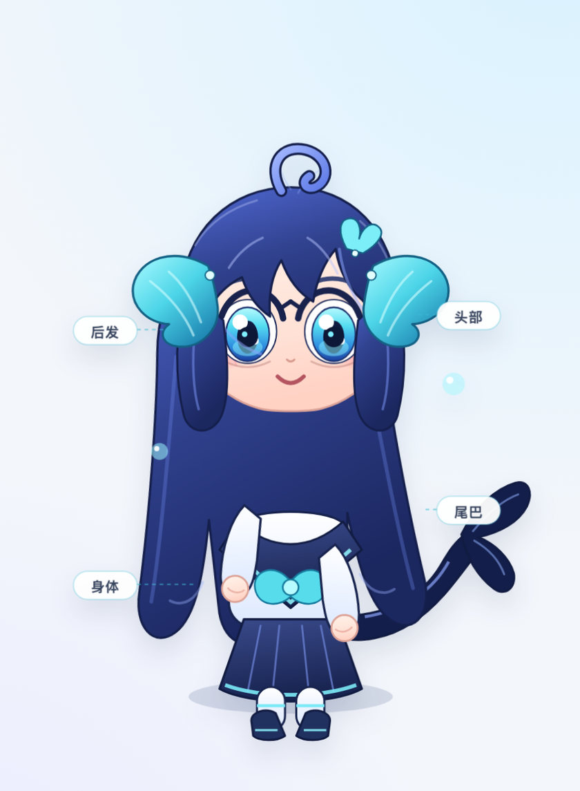
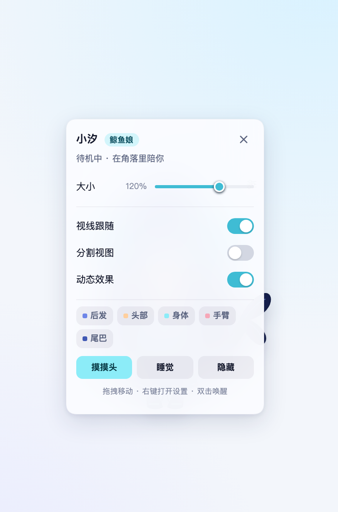
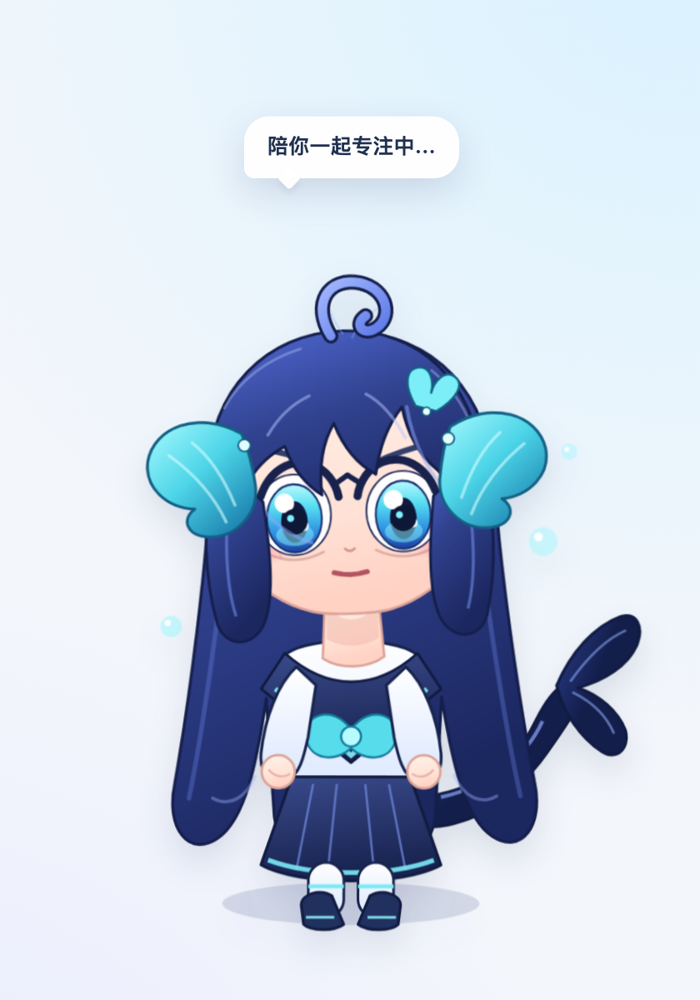
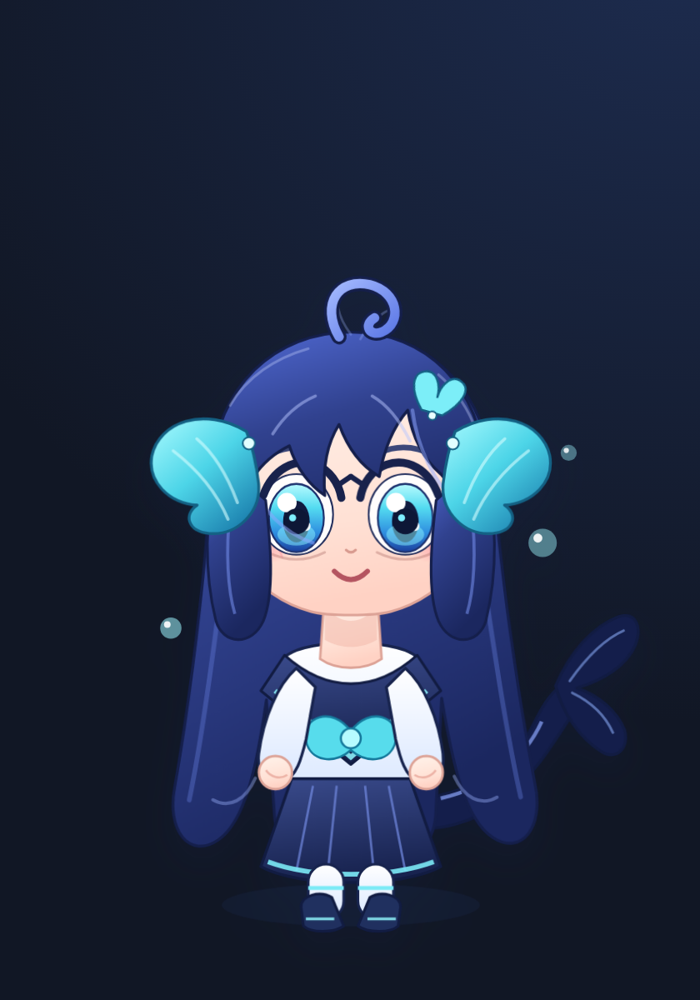

> **仓库里现在有两个插件**：根目录是鲸鱼娘 `dsh-plugin-whale-musume`；新做的狐娘小铃在 [`fox-pet/`](fox-pet/README.md)，包名 `dsh-plugin-fox-pet`。

# 鲸鱼娘小汐 · Whale Musume

**一只住在 DeepSeek Harness 窗口里的二次元鲸鱼娘桌宠。**

像小鲸鱼一样陪你工作，但立绘拆成了后发、头部、身体、手臂、尾巴五个可独立运动的图层：会呼吸、眨眼、追着你的鼠标看、甩尾巴，也可以在「分割视图」里把图层拆开看个究竟。


## 功能

- **分层 2.5D 立绘**：原创 SVG 鲸鱼娘，后发 / 头部 / 身体 / 手臂 / 尾巴分别绑定动画与视差，不是一张静态贴图。
- **分割视图**：一键把图层拉开并显示中文标注；设置面板里的图层标签可以单独高亮某一块，看清楚“二次元是怎么切开的”。
- **陪伴状态**：读取 DSH 公开的会话快照，工作中会陪你专注、有审批 / 提问时举起小牌子、任务结束时跳起来庆祝，并显示进行中的任务数。
- **交互**：拖拽移动、点击摸摸头、双击睡觉 / 唤醒、右键或齿轮打开设置；支持大小、视线跟随、动态效果、隐藏与找回。
- **主题与无痕**：跟随 DSH 的浅色 / 深色语义 Token，支持 `prefers-reduced-motion`；设置只存在浏览器 `localStorage`，不写会话、不联网、不调用模型。
- **纯视觉客户端插件**：挂在公开的 `shell.overlay` 槽位上，不替换任何官方 UI，也不依赖 DOM 结构。

| 分割视图 | 设置面板 |
| --- | --- |
|  |  |

工作时会收起笑脸、盯着任务，旁边还有进行中的任务计数：



深色模式下同样跟随 DSH 的主题 Token：



## 安装

### 方式一：DSH 桌面端（推荐）

1. 打开 DSH 的「插件管理」。
2. 输入本仓库的本地绝对路径，或下文打包出的 `.tgz` 文件路径。
3. 安装完成后完整退出并重新打开 DSH（只关窗口不一定会退出进程）。

### 方式二：CLI（`web` 等自管 profile）

```sh
dsh plugin --profile web add file:/absolute/path/to/deepseek-harness-plugins
```

然后重启 `dsh web`。桌面端 profile 由 Electron 独占管理，不能直接用 CLI 安装，请走应用内插件管理。

安装后默认出现在**左下角**，尺寸 100%。如果同时装了「小鲸鱼」插件，它会待在小鲸鱼对面的角落里。

## 使用

- **拖拽**：按住小汐移动到任意位置，位置会记住。
- **点击**：摸摸头；**双击**：睡觉 / 叫醒。
- **右键**：打开设置；悬停时右上角也会出现齿轮。
- **分割视图**：在设置里打开，五个图层会分开并出现标注。悬停或点击图层标签可以高亮对应部件。
- **大小 / 视线跟随 / 动态效果**：滑块与开关即时生效，刷新后保留。
- **隐藏**：隐藏后左下角会出现「找回小汐」的小鲸尾按钮。

## 状态说明

| 状态 | 触发 | 表现 |
| --- | --- | --- |
| 待机 | 没有进行中的任务 | 呼吸、眨眼、发丝与尾巴摆动 |
| 工作 | 有主会话正在运行 | 认真脸、计数徽标、专注气泡 |
| 等待 | 有审批 / 提问等 pending 交互 | 歪头、举手、问号、提示气泡 |
| 庆祝 | 工作或等待结束 | 闭眼笑、跳起、星星，约 3.4 秒 |
| 睡觉 | 双击或面板里的「睡觉」 | 闭眼、Zzz、放慢呼吸 |
| 摸摸头 | 点击小汐 | 脸红、比心、爱心飘动 |

## 开发

要求 Node.js 22+。

```sh
pnpm install
pnpm build          # 生成 lib/client.js 与离线 preview/preview.js
pnpm test           # 单元测试 + 构建产物 ModuleLoader 契约测试
pnpm preview        # http://127.0.0.1:5173/ 离线预览，不需要 DSH（可用 PORT=5188 改端口）
```

离线预览支持 `?state=working&explode=1&panel=1&bubble=...` 之类的查询参数，方便检查状态与分割视图。

目录：

```text
src/pet/art.js      分层 SVG 立绘
src/pet/styles.js   动画、主题、分割视图
src/pet/view.js     桌宠视图：拖拽、状态机、设置、交互
src/pet/session.js  会话快照的纯函数聚合
src/client.js       DSH Client 插件入口（React 只使用宿主提供的实例）
scripts/build.mjs   esbuild + __ModuleLoader__ 包装
```

## 兼容性与边界

- 在 **DSH 0.2.1-rc.2（macOS arm64）的 Web 客户端**、隔离 profile 中完成加载与交互验证：插件能进入 `shell.overlay`，`useSessions` / `useSessionStatus` 可用，工作 / 等待 / 庆祝 / 拖拽 / 缩放 / 隐藏 / 刷新持久化均通过自动化检查，打包后的 `.tgz` 也单独安装验证过。
- 只使用公开 Slot 和客户端会话快照；没有 Host 服务、Remote、额外端口、模型请求或遥测。
- 不读取聊天正文、工具参数或附件；只统计 `running` 与 `pendingInteraction`。
- 桌面端与网页端使用同一套 Client Slot / 会话快照接口；桌面端尚未修改你当前的 profile 做实测。其他 DSH 版本若调整了 Slot 或快照结构，可能需要小改 `src/client.js`。
- 设置保存在当前浏览器的 `localStorage` 键 `dsh.whale-musume.v1`。

## 许可

代码与原创立绘均以 [MIT License](LICENSE) 发布。DeepSeek Harness 是其权利人的产品；本项目是个人插件，不代表官方。
