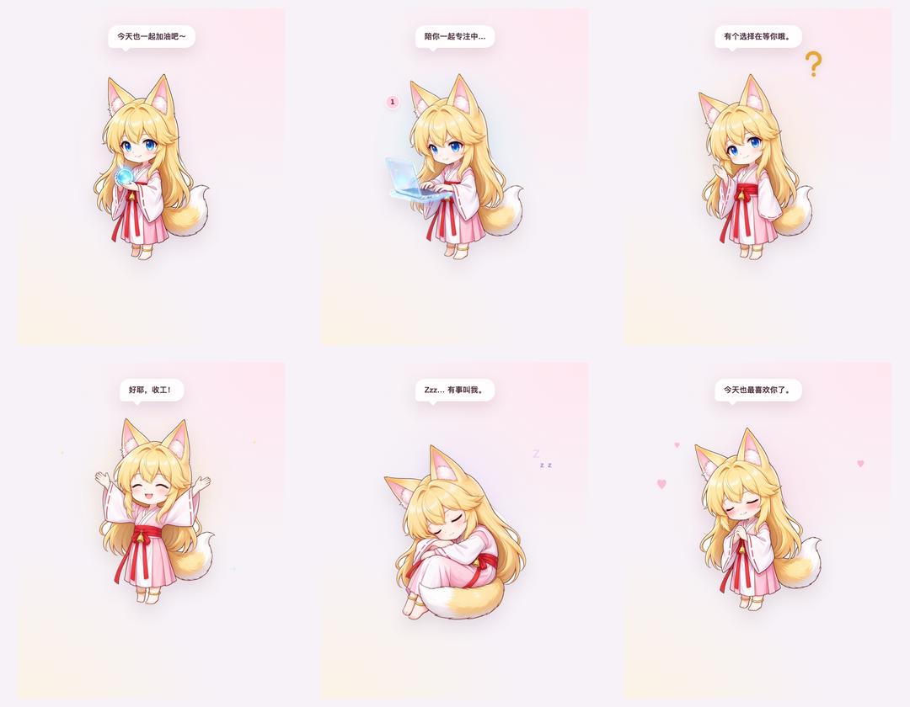
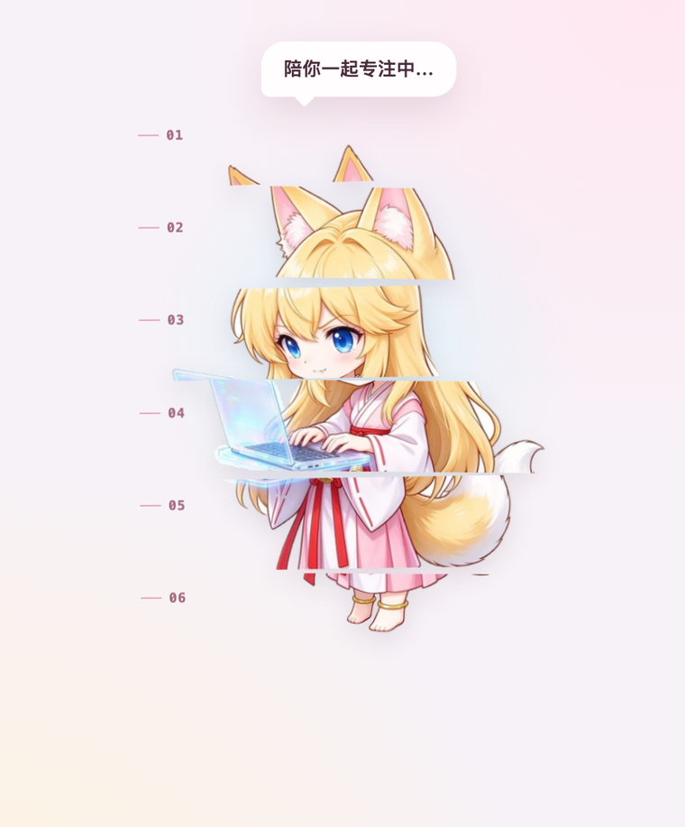
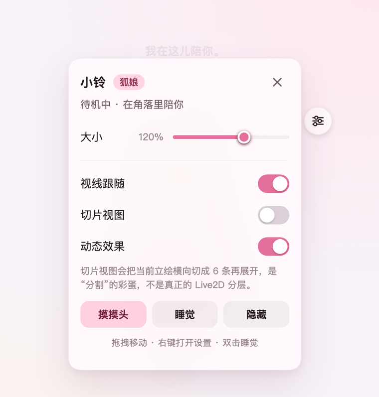

# 狐娘小铃 · Fox Pet

**一只会陪 DeepSeek Harness 工作的二次元狐娘桌宠。**

狐耳、金发、蓝眼睛、粉白巫女服、红腰带、金铃铛、白尖尾巴——六张状态立绘，会跟着 Agent 的工作状态切换。还有一个「切片视图」彩蛋：把当前立绘横向切成 6 条再展开，算是对最初「二次元分割」想法的保留。



## 功能

- **六种状态**：待机、工作（抱着全息笔记本）、等待确认、完成庆祝、睡觉、摸摸头。
- **和 Agent 联动**：读取 DSH 公开的会话快照——有任务运行时切到工作状态并显示任务数，有审批 / 提问时举手等待，任务结束跳起来庆祝。
- **切片视图**：设置里打开，当前立绘会被切成 6 条向两侧展开，再合回去；纯视觉彩蛋，不写会话。
- **交互**：拖拽移动、点击摸摸头、双击睡觉 / 叫醒、右键或齿轮打开设置；大小、视线跟随、切片视图、动态效果、隐藏都能记住。
- **主题**：跟随 DSH 浅色 / 深色语义 Token，支持 `prefers-reduced-motion`。
- **纯客户端**：挂在 `shell.overlay` 槽位，不替换官方 UI、不联网、不调用模型、不读聊天正文。

| 切片视图 | 设置面板 |
| --- | --- |
|  |  |

## Agent 状态怎么映射

| Agent 状态 | 小铃的表现 |
| --- | --- |
| 主会话运行中 | 工作状态（全息笔记本）+ 「陪你一起专注中…」+ 任务计数 |
| 有审批 / 提问 pending | 等待状态（举手）+ 问号 + 「这里需要你看一下～」 |
| 工作或等待结束 | 庆祝状态 + 星星 + 「完成啦！辛苦辛苦～」，约 3.4 秒 |
| 没有任务 | 待机，抱着灵珠呼吸 |
| 你手动让她睡觉 | 蜷成一团、Zzz；工作开始会叫醒 |
| 点击 / 摸摸头 | 闭眼脸红、比心 |

数据只读取 `running` 和 `pendingInteraction`，不读取对话内容。

## 安装

### 直接安装打包好的 tgz

在 DSH 桌面端「插件管理」里选择：

```text
/Users/blding/codespace/deepseek-harness-plugins/fox-pet/artifacts/dsh-plugin-fox-pet-0.1.0.tgz
```

安装后完整退出并重新打开 DSH。

### CLI（web 等自管 profile）

```sh
dsh plugin --profile web add file:/Users/blding/codespace/deepseek-harness-plugins/fox-pet/artifacts/dsh-plugin-fox-pet-0.1.0.tgz
```

## 使用

- **拖拽**：移动位置，位置会记住。
- **点击**：摸摸头；**双击**：睡觉 / 叫醒。
- **右键**：打开设置；悬停时右上角出现齿轮。
- **切片视图**：设置 → 切片视图。
- **隐藏**：隐藏后左下角出现「找回小铃」。

## 开发

要求 Node.js 22+。

```sh
pnpm install
pnpm build          # 内联六张 WebP 状态图，生成 lib/client.js
pnpm test           # 会话聚合 + ModuleLoader 产物契约
pnpm preview        # http://127.0.0.1:5173/ 离线预览
```

离线预览参数：

```text
?state=idle|working|waiting|celebrate|sleeping|pat
?slice=1&panel=1&scale=1.35&bubble=...
```

目录：

```text
assets/states/*.webp  六张透明状态图（768×768）
src/pet/sprites.js    以 data URL 方式被 esbuild 内联
src/pet/view.js       状态机、拖拽、切片视图、设置
src/pet/styles.js     动画、主题、面板、切片
src/client.js         DSH Client 插件入口
scripts/build.mjs     esbuild + __ModuleLoader__ 包装
```

## 兼容性与边界

- 在 **DSH 0.2.1-rc.2（macOS arm64）的 Web 客户端**、隔离 profile 中完成加载与交互验证；打包后的 `.tgz` 单独安装也验证过。
- 桌面端使用同一套 Client Slot / 会话快照接口；尚未修改你当前的桌面 profile 做实测。
- 图片由参考图经「豆包 AI」生成，再由本项目抠图、统一比例、切成透明状态图。公开发布前请确认参考立绘与生成图的使用授权；角色设定与最终图片的权利归相应权利人。
- 代码以 MIT 发布；图片素材不自动适用 MIT，随本项目本地使用。

## 许可

代码：[MIT](LICENSE)。图片素材：见上方说明。
